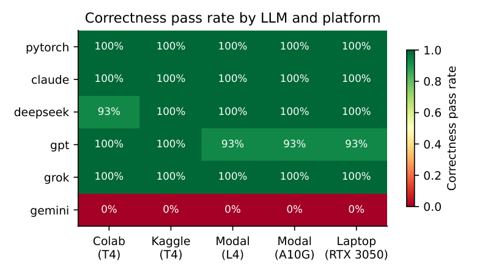
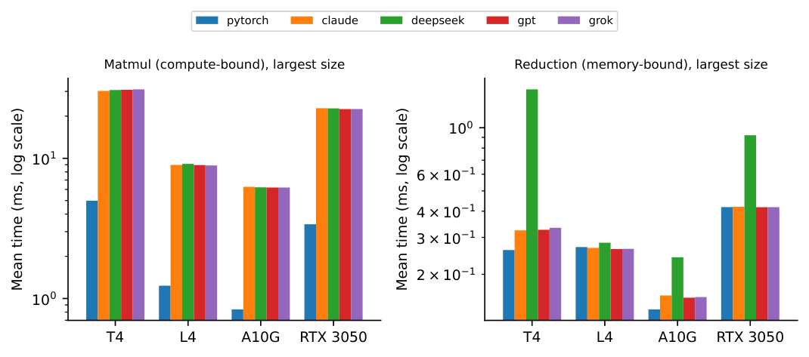
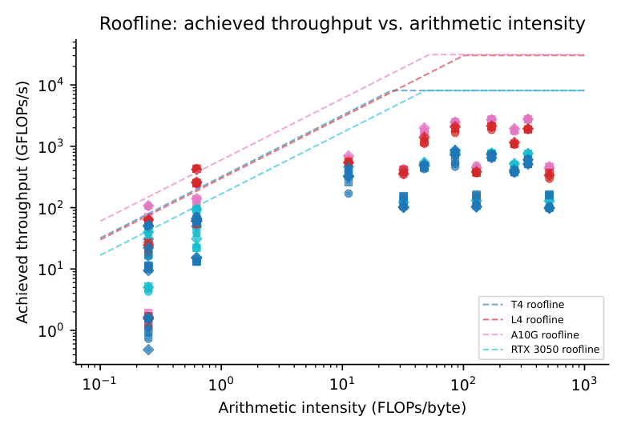
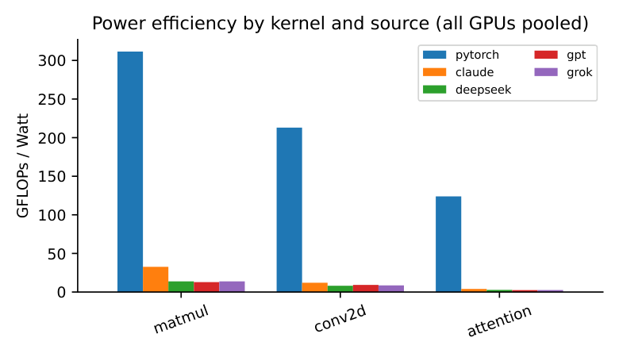
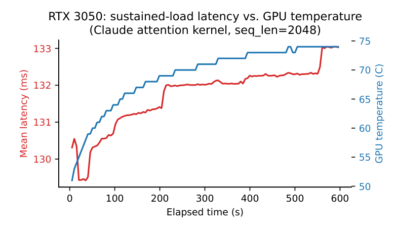
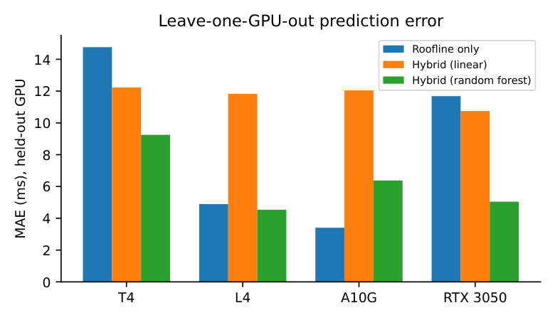

# LLM-Generated GPU Kernel Benchmarking & Cross-GPU Performance Prediction

Comparative study of raw CUDA kernels generated by five frontier LLMs (Claude, GPT, Gemini, Grok,
DeepSeek) vs. native PyTorch, benchmarked across five platforms (Google Colab, Kaggle, Modal
(L4 + A10G), and a laptop RTX 3050 over SSH), plus a hybrid roofline + regression model that
predicts a kernel's performance on an unmeasured GPU from its spec sheet alone.

The full IEEE-format write-up is in [`report/paper.pdf`](report/paper.pdf) ([LaTeX source](report/paper.tex)).
A web-readable version of the same report, with figures, is below.

Note on "temperature" as a tracked parameter: this means **GPU thermal temperature** during a
sustained run (does it throttle clocks and slow down as it heats up — especially relevant on the
laptop RTX 3050's weaker cooling), not LLM sampling temperature. LLM sampling temperature is also
recorded per generation (`gen_temperature` in each `*.meta.json`) but is usually "unspecified"
since generation happens through chat UIs rather than the API.

## Layout
- `kernels/<name>/pytorch_baseline.py` — reference PyTorch implementation + input generator for each kernel.
- `kernels/<name>/llm_<llm>/v1.py` + `v1.meta.json` — LLM-generated CUDA implementation (built via `torch.utils.cpp_extension.load_inline`) + generation provenance.
- `prompts/` — exact prompt given to every LLM per kernel (identical across LLMs for a fair comparison), plus `rubric.md` for scoring prompt quality.
- `gpu_specs/specs.csv` — static hardware specs per GPU (used by the roofline predictor).
- `harness/bench.py` — loads an implementation, times it with CUDA events, checks correctness against the PyTorch reference.
- `harness/power_logger.py` — background power/temperature sampler (pynvml / nvidia-smi) used during each short timed run.
- `harness/thermal_sweep.py` — sustained-load sweep that samples GPU temp/clock/power every few seconds over minutes, to see how rising GPU temperature affects performance.
- `harness/runner.py` — CLI that sweeps kernel x implementation x input size x dtype and writes result rows.
- `results/raw/<platform>/*.csv` — one row per run, merged into `results/combined/all_results.parquet`; `results/thermal/<platform>/` — thermal-sweep time series.
- `results/raw_kaggle_run2_separate/` — a second, independent Kaggle (Tesla T4) sweep, kept deliberately out of the main combined dataset, used only to measure run-to-run variance on shared cloud GPUs.
- `analysis/roofline.py` — Step A analytical predictor. `analysis/residual_model.py` — Step B regression correction + leave-one-GPU-out validation. `analysis/make_report_assets.py` — generates every figure/number below from the merged dataset.
- `report/` — IEEE paper (`paper.tex`/`paper.pdf`), figures, and `numbers.json` (every number in this README and the paper, traceable to the dataset).
- `deploy/kaggle/run.py` + `kernel-metadata.json`/`dataset-metadata.json` — the actual script and Kaggle kernel/dataset config used to run the harness on Kaggle's free T4 (handles Kaggle's auto-extraction of the uploaded project zip).
- `deploy/modal/app.py` — the Modal app definition used to run the harness on Modal's L4/A10G GPUs (builds a CUDA-devel image, timeout-capped for credit safety; run from inside `deploy/modal/`).

## Quickstart
```
pip install -r requirements.txt
python harness/runner.py --kernel matmul --sizes 512,1024,2048 --dtype fp32 --platform colab
```
Each run appends to `results/raw/<platform>/`. Run `analysis/merge_results.py` to combine runs,
then `analysis/make_report_assets.py` to regenerate every figure and number in this README/the paper.

## RTX 3050 laptop setup (reproducible recipe)

The laptop had no system CUDA toolkit (`nvcc` not found) and no conda. A pure-pip toolchain works,
but required three specific fixes -- **do these in order** if rebuilding the venv from scratch:

```bash
python3 -m venv venv && source venv/bin/activate
pip install torch 'nvidia-cuda-nvcc==13.2.86' ninja pynvml pyyaml pandas
```

1. **PTX ISA mismatch**: `nvidia-cuda-nvcc==13.2.86`'s own bundled `ptxas` is too old for its own
   `cicc`'s output (`ptxas ... Unsupported .version 9.5; current version is '9.2'`). This specific
   version is required anyway because it's the only one whose headers satisfy the CCCL
   compatibility check (`cuda_toolkit.h` `#error`) -- other nvcc versions (13.0.x, 13.3.x, 13.5.x)
   fail that check instead. Fix: pull a newer `ptxas` from a later release and swap it in:
   ```bash
   pip download --no-deps -d /tmp/nvcc_new nvidia-cuda-nvcc==13.5.37
   python3 -m zipfile -e /tmp/nvcc_new/*.whl /tmp/nvcc_new/extracted/
   cp /tmp/nvcc_new/extracted/nvidia/cu13/bin/ptxas venv/lib/python3.12/site-packages/nvidia/cu13/bin/ptxas
   ```
2. **Missing linker symlink**: the package ships `libcudart.so.13` but not the unversioned
   `libcudart.so` that `-lcudart` needs at link time:
   ```bash
   cd venv/lib/python3.12/site-packages/nvidia/cu13/lib && ln -sf libcudart.so.13 libcudart.so
   ```
3. **Env vars every run** (PATH must NOT rely on `triton`'s own bundled `ptxas`, which is a
   different, incompatible version):
   ```bash
   export CUDA_HOME=$PWD/venv/lib/python3.12/site-packages/nvidia/cu13
   export PATH=$CUDA_HOME/bin:$PATH
   ```

All three fixes stay entirely inside the venv -- no sudo, no system changes.

---

# Report: Comparative Analysis & Cross-GPU Performance Prediction

*(Markdown version of [`report/paper.pdf`](report/paper.pdf); all numbers come straight from [`report/numbers.json`](report/numbers.json), regenerated by `analysis/make_report_assets.py` from the merged dataset.)*

## Summary

Five frontier LLMs (Claude, GPT, Gemini, Grok, DeepSeek) each generated raw CUDA kernels for five
operations spanning the roofline spectrum — parallel reduction and softmax (memory-bound), and
matmul, conv2d, and attention (compute-bound). Every kernel was benchmarked against a native
PyTorch baseline, gated on numerical correctness, across four GPUs spanning three architecture
generations (Tesla T4/Turing, NVIDIA L4/Ada Lovelace, NVIDIA A10G/Ampere, RTX 3050 Laptop/Ampere)
and five execution platforms. **450 result rows, 371 passing correctness.**

| GPU | Platform(s) | Arch. | SMs | Mem BW (GB/s) | FP32 TFLOPs | TDP (W) |
|---|---|---|---|---|---|---|
| Tesla T4 | Colab, Kaggle | Turing | 40 | 320 | 8.1 | 70 |
| NVIDIA L4 | Modal | Ada Lovelace | 58 | 300 | 30.3 | 72 |
| NVIDIA A10G | Modal | Ampere | 72 | 600 | 31.2 | 300 |
| RTX 3050 Laptop | SSH (friend's laptop) | Ampere | 20 | 168 | 8.1 | 80 |

## 1. Correctness

Overall pass rate by source: **Claude 100%, Grok 100%, DeepSeek 98.7%, GPT 96.0%, Gemini 0%.**



Three reproducible defects, each confirmed across multiple independent platforms:

- **Gemini — systematic compilation failure.** All 25 generated kernels fail to compile, every
  time, for the identical reason: calls to `at::cuda::getCurrentCUDAStream()` and
  `C10_CUDA_KERNEL_LAUNCH_CHECK()` without including the headers that declare them
  (`<ATen/cuda/CUDAContext.h>`, `<c10/cuda/CUDAException.h>`). A systematic training/prompting gap,
  not an isolated mistake.
- **GPT — architecture-dependent correctness bug.** GPT's attention kernel fails its correctness
  check at the smallest tested shape `(8, 8, 128, 64)` on every Ampere/Ada GPU tested (L4, A10G,
  RTX 3050) and **passes on Turing (T4)**, reproduced independently three times on three separate
  GPUs. The same compiled binary genuinely behaves differently depending on compute capability —
  a class of bug a single-GPU validation would never catch.
- **DeepSeek — borderline numerical non-determinism.** DeepSeek's `atomicAdd`-based reduction
  kernel fails intermittently at its largest size (16,777,216 elements): failed on Colab's T4,
  passed on Kaggle's first T4 run, *failed* on Kaggle's second independent T4 run, passed on L4,
  A10G, and RTX 3050. Inconsistent even across identical hardware and code — this is thread-
  scheduling nondeterminism sitting right at the tolerance boundary, not a clean deterministic bug.

**A measurement caveat worth flagging**: Ampere/Ada GPUs enable TensorFloat-32 (TF32) by default
in cuDNN/cuBLAS, silently lowering the PyTorch reference's precision relative to the hand-written
FP32 CUDA kernels it's checked against (Turing has no TF32 path, so it's unaffected). Before we
explicitly disabled it (`torch.backends.{cudnn,cuda.matmul}.allow_tf32 = False`), several conv2d/
attention checks failed *spuriously* on the L4 — not because the generated kernels were wrong, but
because the reference itself was computing a different, lower-precision result.

## 2. Performance



The PyTorch baseline is **5–25× faster** than every LLM-generated kernel on every GPU for the
compute-bound kernels, reflecting cuDNN/cuBLAS's maturity vs. a single-shot LLM-generated
implementation. For matmul specifically, all four working LLMs land within a few percent of each
other on every GPU (they converged on a similar shared-memory tiling strategy).

Attention is where implementation *strategy*, not just hardware, decides the outcome. DeepSeek's
attention kernel implements genuine online-softmax ("flash-attention style") accumulation; Claude
and GPT keep a full per-row score buffer in shared memory; Grok materializes the entire attention
matrix in global memory. Mean latency (ms) at the largest tested size (seq_len 2048):

| GPU | DeepSeek | Claude | GPT | Grok |
|---|---|---|---|---|
| Tesla T4 | **40.6** | 61.8 | 64.5 | 65.8 |
| NVIDIA L4 | **17.7** | 21.6 | 26.1 | 19.1 |
| NVIDIA A10G | **14.2** | 14.4 | 19.5 | 14.7 |
| RTX 3050 | **43.4** | 49.0 | 67.7 | 50.8 |

DeepSeek's attention kernel is the fastest LLM-generated implementation on **every single GPU
tested**, by 13–44%, purely from algorithmic choice.



Every passing measurement sits well below its GPU's theoretical roofline ceiling — expected, since
none of the generated kernels implement GPU-generation-specific tricks (double buffering,
tensor-core paths) that the heavily-tuned PyTorch baseline benefits from.

## 3. Power Efficiency



PyTorch is **10–50× more power-efficient** than any LLM-generated kernel, and the gap *widens*
with kernel complexity: ~2.4× for matmul (311.5 vs. 12.9–32.6 GFLOPs/W) but ~30–50× for attention
(123.9 vs. 2.5–4.0 GFLOPs/W).

## 4. Run-to-Run Variance on Shared Cloud GPUs

To check whether a single free-tier cloud GPU run is representative, we pushed an independent
second sweep to Kaggle (same Tesla T4 model, same code, hours later — kept in
`results/raw_kaggle_run2_separate/`, deliberately separate from the main dataset). Matching 74
(kernel, LLM, size) cells across both runs:

- Mean timing difference: **-4.1%**, std **11.2%**, range **-38.8% to +43.8%**
- The largest deviations were *not* random noise: matmul at the largest size was **consistently
  18–21% faster** in the second run across all four working LLMs simultaneously, pointing to a
  systematic hardware/tenancy difference between sessions, not per-kernel jitter.
- **One correctness outcome flipped** between runs on identical hardware/code: DeepSeek's largest
  reduction passed in run 1, failed in run 2 — confirming that specific failure mode really is
  run-to-run nondeterminism.

## 5. Sustained-Load Thermal Behavior (RTX 3050)



A 10-minute sustained-load sweep (Claude's attention kernel, largest size, sampled every 5s):
temperature rose **51°C → 74°C** while power stayed essentially flat at **79.8 ± 0.07 W** the
entire run — the GPU was **power-limited by its 80W budget from the very first measurement**, not
thermal-limited. Clock speed drifted down modestly (1927 → 1897 MHz, -1.6%) once temperature
passed ~70°C, and latency correspondingly crept up 2.6% (129.6ms → 133.0ms) — a mild, real
secondary throttle layered on a power ceiling, not a thermal cliff.

## 6. Hybrid Roofline + Regression Predictive Model

**Step A (roofline):** `t_pred = max(FLOPs / peak_compute, Bytes / peak_bandwidth)` computed purely
from a GPU's spec sheet — no measurement of the target GPU required. Roofline-only MAE: T4
14.76ms, L4 4.89ms, A10G 3.41ms, RTX 3050 11.68ms.

**Step B (hybrid):** fit a regressor (linear / random forest) on `actual - t_pred` residuals using
GPU spec features + kernel arithmetic intensity, then validate via **leave-one-GPU-out
cross-validation** (train on 3 GPUs, test on the 4th, with zero data from it):



| Held-out GPU | Roofline only | Hybrid (linear) | Hybrid (random forest) |
|---|---|---|---|
| Tesla T4 | 14.76 ms | 12.23 ms (+17.2%) | **9.25 ms (+37.3%)** |
| NVIDIA L4 | 4.89 ms | 11.82 ms (-141.6%) | 4.53 ms (+7.3%) |
| NVIDIA A10G | 3.41 ms | 12.05 ms (-253.4%) | 6.38 ms (-87.1%) |
| RTX 3050 Laptop | 11.68 ms | 10.75 ms (+8.0%) | **5.05 ms (+56.8%)** |

The random-forest correction improves on the analytical roofline baseline for **3 of 4** held-out
GPUs, substantially for the T4 and RTX 3050, but makes the A10G prediction markedly *worse*. Read
honestly: four GPUs spanning three architecture generations is on the edge of what's needed for
this kind of correction term to generalize, not clearly enough of it yet — the A10G result is
reported as a real limitation, not smoothed over.

## Limitations

1. Each (LLM, kernel) pair was generated exactly once — can't yet distinguish a reliably-buggy
   model from an unlucky single sample.
2. Kernels were generated via chat UIs, not each provider's API, so sampling temperature wasn't
   controlled or recorded.
3. Only three input sizes per kernel — enough to establish direction, not to fit a precise scaling
   curve.
4. Four GPUs is a small sample for a regression meant to generalize to arbitrary unmeasured
   hardware (see the A10G result above).
5. Reported speedup/efficiency ratios are against a single PyTorch baseline implementation each;
   per [KernelBench-Verified](https://arxiv.org/abs/2607.16241), such ratios can be inflated by a
   weak or non-representative baseline, so they should be read as relative to *this specific*
   PyTorch implementation, not a definitive ceiling.

## Related Work

- Williams, Waterman & Patterson, ["Roofline: An insightful visual performance model for multicore architectures"](https://doi.org/10.1145/1498765.1498785), CACM 52(4), 2009.
- Ouyang et al., ["KernelBench: Can LLMs Write Efficient GPU Kernels?"](https://arxiv.org/abs/2502.10517), ICML 2025.
- Zhu et al., ["CUDABench: Benchmarking LLMs for Text-to-CUDA Generation"](https://arxiv.org/abs/2603.02236), 2026.
- Sarkar, ["The Correctness Illusion in LLM-Generated GPU Kernels"](https://arxiv.org/abs/2606.20128), 2026.
- Wang et al., ["KernelBench-X: A Comprehensive Benchmark for Evaluating LLM-Generated GPU Kernels"](https://arxiv.org/abs/2605.04956), 2026.
- Zhang et al., ["KernelBench-Verified: Do LLM-Generated Kernels Actually Beat PyTorch?"](https://arxiv.org/abs/2607.16241), 2026.

See [`report/paper.tex`](report/paper.tex) / [`report/paper.pdf`](report/paper.pdf) for the full
IEEE-format version with complete methodology, NVIDIA architecture whitepaper citations, and the
full discussion section.
